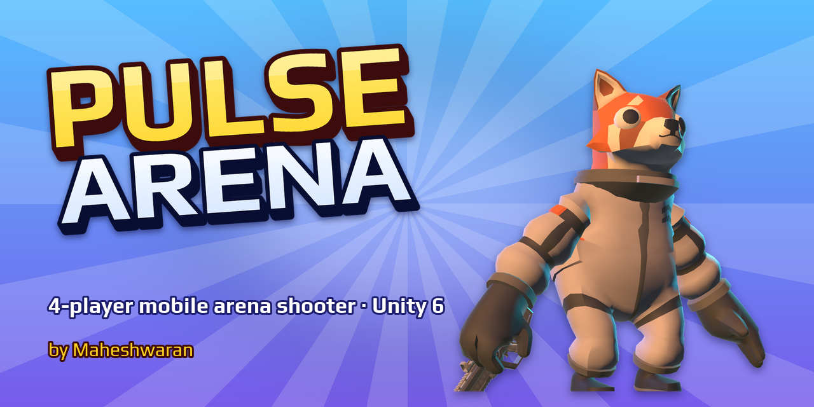
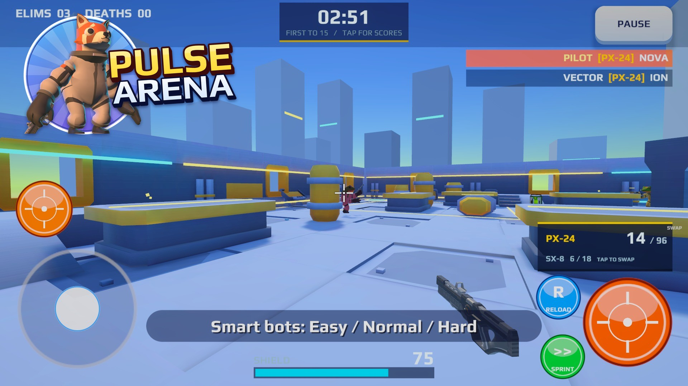
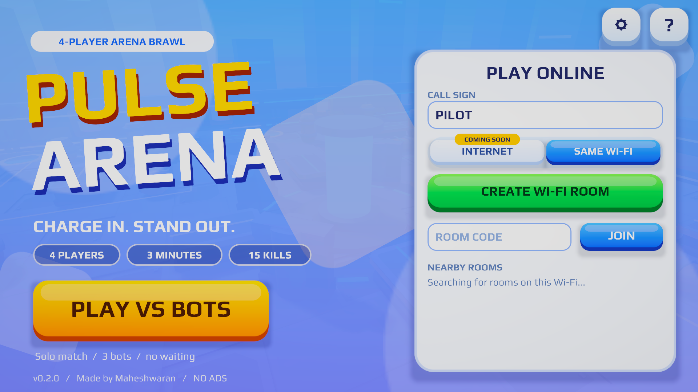
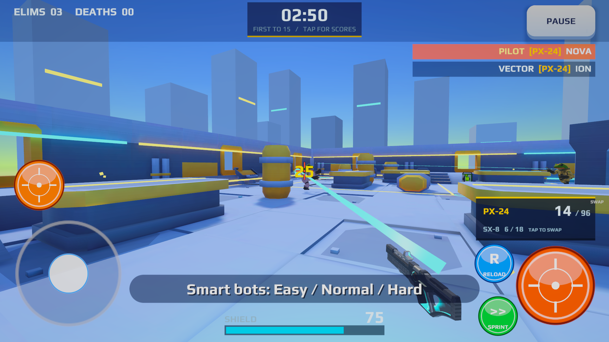
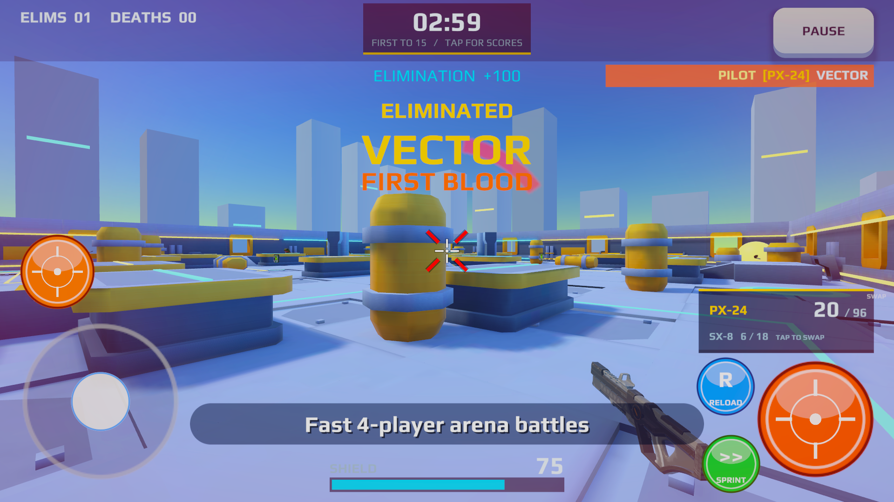
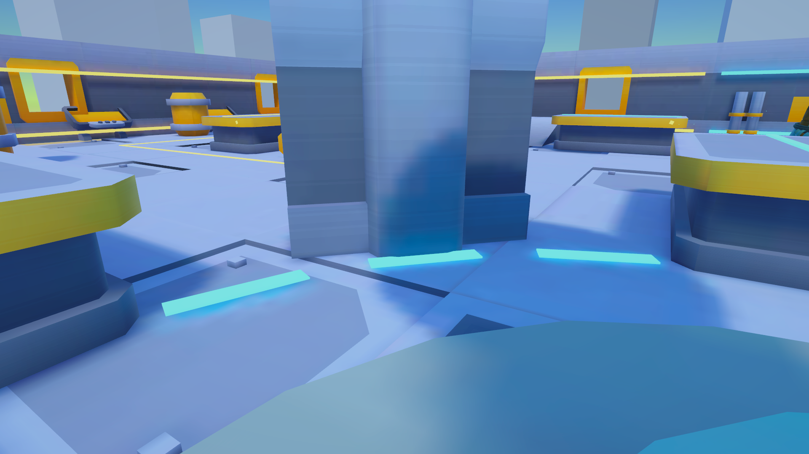
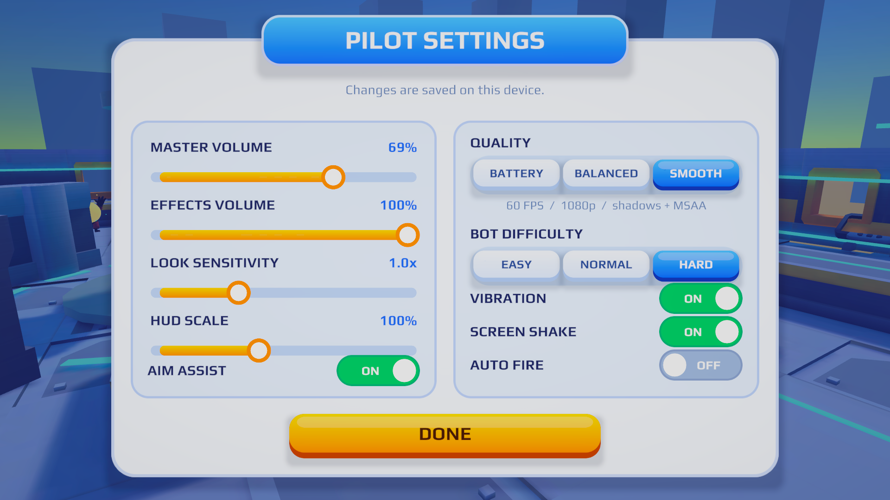
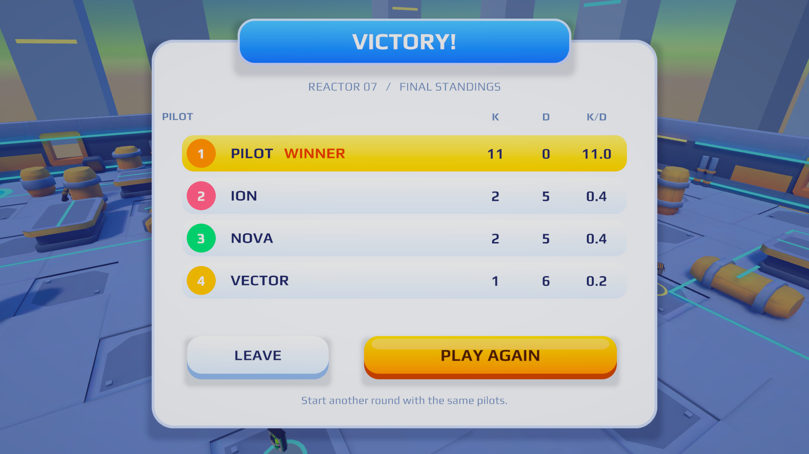

<p align="center">
  
</p>

<h1 align="center">Pulse Arena</h1>
<p align="center"><b>Four pilots. One bright arena. Fast, stylized firefights on your phone.</b></p>

<p align="center">
  
  
  
  
  
  
</p>

Pulse Arena is a 4-player mobile arena shooter built in Unity 6 for Android in landscape. Rounds last three minutes, first to 15 eliminations wins, and you can play offline against bots or with friends on the same Wi-Fi. There are no ads and no purchases.

## 🎬 Watch the trailer

[](docs/media/trailer.mp4)

Click the thumbnail to play the trailer (`docs/media/trailer.mp4`). The release page has the playable build.

## 📥 Download

Get the latest APK from the **[Releases page](https://github.com/MAHESH21723/PulseArena/releases/latest)**.

- Requires **Android 8.0 or newer** (API 26) on an **ARM64** phone, in landscape.
- Allow "Install unknown apps" for your browser or file manager, open the APK and install. Details are in [docs/RELEASE_NOTES_v0.3.0.md](docs/RELEASE_NOTES_v0.3.0.md).

## 📸 Screenshots

<table>
  <tr>
    <td></td>
    <td></td>
    <td></td>
  </tr>
  <tr>
    <td align="center">Menu</td><td align="center">Gameplay</td><td align="center">Elimination</td>
  </tr>
  <tr>
    <td></td>
    <td></td>
    <td></td>
  </tr>
  <tr>
    <td align="center">Arena</td><td align="center">Settings</td><td align="center">Results</td>
  </tr>
</table>

## ✨ Features

**Gameplay**
- Free-for-all, up to 4 players. Three-minute rounds; first to 15 eliminations, or the highest score when time runs out.
- Three-second countdown, three-second respawns, and standings and rematches on the results screen.
- Two weapons: the **PX-24 Pulse Carbine** (accurate, 24-round magazine) and the **SX-8 Scatter Cannon** (8 pellets, 6 shells, short range). Swap at any time and reload manually.
- Shield pickups and ammo pickups around the arena that respawn on a timer.

**Feel and juice**
- Hit markers, floating damage numbers, a kill feed, muzzle flashes, tracers and impact effects.
- Camera shake and optional haptics (both can be turned off), plus a low-shield warning.
- Animated pilots with footsteps, hit reactions and elimination animations.

**Bots**
- Offline practice against three bots at Easy, Normal or Hard.
- Bots navigate with Unity AI Navigation, use cover, seek shield and ammo pickups, react to sound and sight, and fire in bursts. Difficulty changes reaction time, turn speed, aim error and cover use.

**Aim assist and controls**
- Touch controls: left pad moves, drag the right side to look, hold Fire or Sprint, tap Reload. Sprinting prevents shooting.
- Mobile-style aim assist for the local player: look friction near targets, gentle magnetism toward centre mass, and optional auto-fire. Strength is adjustable in settings. The server still decides every hit.
- Desktop test controls: WASD, mouse, left-click fire, R reload, Q swap (or 1 / 2), Shift sprint, Esc pause.

**Audio**
- A mastered sound bank: layered gunshots, reloads, hit and kill confirms, pickups, footsteps, UI sounds, countdown and match jingles. See [CREDITS.md](CREDITS.md).

**Display and performance**
- Responsive HUD and menus designed for 4:3 up to 21:9, with an adjustable HUD scale.
- Three quality presets: **Battery** (30 FPS, about 720p, no shadows), **Balanced** (60 FPS, about 900p, shadows), **Smooth** (60 FPS, about 1080p, shadows, 2x MSAA).

## 🌐 Online

| Mode | Status |
| --- | --- |
| Offline practice vs. bots | Available |
| **Same Wi-Fi** rooms (one phone hosts; nearby rooms are discovered automatically, or type the 6-character room code) | Available |
| **Internet** rooms via Epic Online Services | **Coming soon** |

Internet play will use Epic Online Services: free, peer-to-peer, with no server bills. The lobby and login code exists behind the `PULSE_EOS` define, but the Netcode transport over EOS P2P is not built yet, so the game shows "Internet unavailable". See [ONLINE_SETUP.md](ONLINE_SETUP.md). Unity Relay and Multiplayer Services were removed to keep the project free to run.

## 🧱 Tech stack and architecture

Unity 6 (6000.6.2f1), Universal Render Pipeline 17.6, Netcode for GameObjects 2.13, Input System, TextMeshPro (uGUI), AI Navigation.

Gameplay is host-authoritative: one phone runs the simulation for movement, hits, damage, ammo, scoring and timer. This is a casual architecture, not a dedicated competitive server or anti-cheat.

| Script (`Assets/PulseArena/Runtime`) | Responsibility |
| --- | --- |
| `PulseApp.cs` | Startup, camera, room lifecycle, settings |
| `PulseCore.cs` | Shared contracts: `WeaponDef`, pickups, bot difficulty, settings keys, `PulseEvents` |
| `ArenaMatch.cs` | Round state: countdown, 3 min timer, first to 15 |
| `ArenaPlayer.cs` | Networked player: movement, weapons, damage, respawn |
| `BotBrain.cs`, `Bots/BotNav.cs` | Bot decisions, difficulty profiles and navigation |
| `PulseAim.cs` | Aim assist and auto-fire (local pilot only) |
| `PulseInput.cs`, `PulseDisplay.cs` | Touch and desktop input; aspect handling and quality presets |
| `PulseUI.cs`, `UI/` (`PulseHud`, `UiKit`, ...) | Menus, HUD, hit markers, damage numbers, kill feed |
| `PulseEffects.cs`, `World/` | Visual effects, arena layout, pickups, pilot animation |
| `PulseAudio.cs`, `Audio/` | Sound bank playback and haptics |
| `PulseOnline.cs`, `Online/` | Room services: LAN (`LanRoomService`, `LanDiscovery`) and EOS (`EosRoomService`, `PULSE_EOS`) |
| `PulseSmoke.cs`, `PulseTouchCheck.cs` | Development-only integration and touch checks |

Presentation code (audio, HUD, effects, haptics) listens to `PulseEvents` and never changes game state.

## 🛠 Build from source

**Requirements:** Unity **6000.6.2f1** with the Android Build Support module (OpenJDK, SDK and NDK). Windows is the tested development platform.

1. Clone the repository and open the folder in Unity Hub with 6000.6.2f1.
2. Open `Assets/PulseArena/Scenes/PulseArena.unity` and press Play. Use **Practice with bots** for a quick match.
3. The `Pulse Arena` menu holds the build steps: `1. Import UI Resources`, `2. Generate Game`, `3. Bake Lighting`, `Build Fonts`, `Build Sound Bank`, `Build Windows Test Player`, `Build Android Test APK` (debug-signed, for testing) and `Build Play Store AAB` (release-signed).

**Headless builds** (close any editor using the project first; logs should report `PULSE_BUILD_OK`):

```powershell
Unity.exe -batchmode -quit -projectPath . --burst-disable-compilation -executeMethod PulseArena.Editor.PulseBuilder.AndroidTest
Unity.exe -batchmode -quit -projectPath . --burst-disable-compilation -executeMethod PulseArena.Editor.PulseBuilder.AndroidRelease
```

**Play-mode tests** (`PulseEditorTests`; modes `practice` and `screens`; exit code 0 = pass, 2 = fail, 3 = timeout). The runner enters Play Mode inside the editor itself, so it is started without `-batchmode`:

```powershell
Unity.exe -projectPath . --burst-disable-compilation -executeMethod PulseArena.Editor.PulseEditorTests.Run -pulse-test practice -test-output QA\v0.3\Practice
```

**Signing.** Release builds read these names from your environment or a local `.env` (never committed; copy `.env.example` and fill it in): `PULSE_APPLICATION_ID`, `PULSE_KEYSTORE`, `PULSE_KEY_ALIAS`, `PULSE_KEYSTORE_PASSWORD`, `PULSE_KEY_PASSWORD`. The internet-mode variables (`EOS_*`) are only needed once EOS support is finished. See [RELEASE_GUIDE.md](RELEASE_GUIDE.md).

## 📁 Project structure

```
Assets/PulseArena/
  Runtime/      game code (see table above)
  Editor/       PulseBuilder (scene generation, builds), PulseEditorTests, asset builders
  Scenes/       PulseArena.unity
  Resources/    generated materials, brand assets
  ThirdParty/   CC0 models and sounds, Play font (licences included)
Packages/       manifest.json (Netcode, URP, Input System, AI Navigation)
Tools/          PowerShell build, signing and validation scripts
QA/             recorded test evidence
docs/           release notes and media
```

## 🙏 Credits

Models and sound effects are CC0 (Kenney, Quaternius, and several OpenGameArt authors); the UI font Play is licensed under the SIL Open Font License. Full list in [CREDITS.md](CREDITS.md).

## 👤 Author

**Maheshwaran** - [github.com/MAHESH21723](https://github.com/MAHESH21723) - [kmaheshwaran9965@gmail.com](mailto:kmaheshwaran9965@gmail.com)

## Licence

All rights reserved: code (c) Maheshwaran. Third-party assets are under their own licences (see [CREDITS.md](CREDITS.md)).
